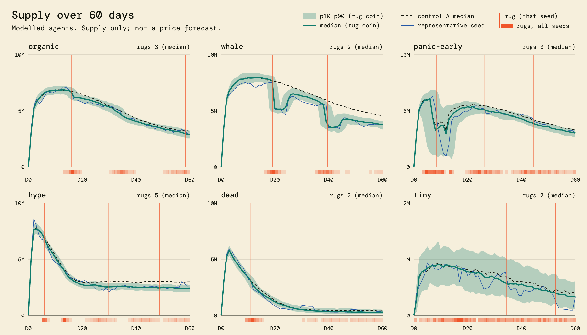
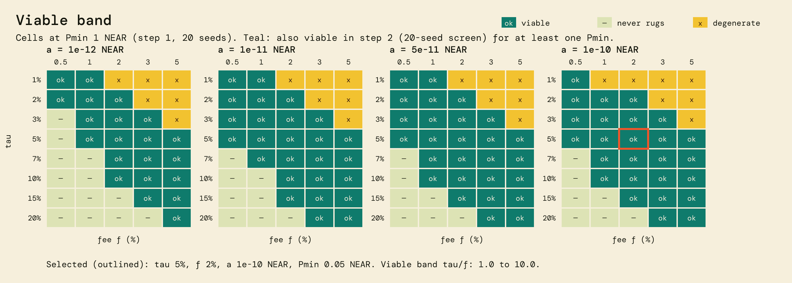
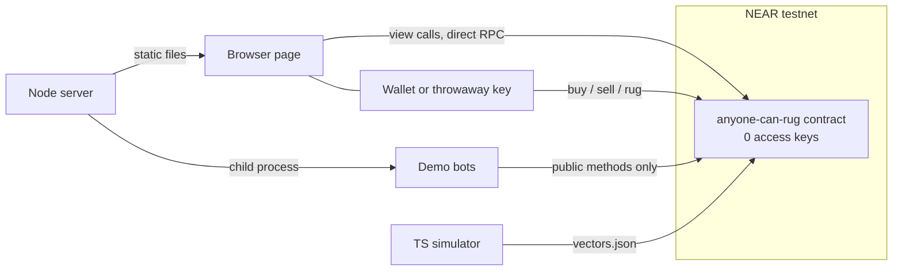

# Anyone Can Rug ($RUGPRICE)

*Every coin has a rug price. This one prints it.*

A NEP-141 memecoin on NEAR testnet where the rug is a public, priced, permissionless contract method. Built at NEAR HACKATHON, track `memecoins`.

| | |
|---|---|
| Live demo | https://web-production-69c90.up.railway.app |
| Contract (simulated parameters) | [`anyonecanrug.testnet`](https://testnet.nearblocks.io/address/anyonecanrug.testnet) |
| Contract (fast demo instance, tuned to rug often) | [`rugfast.acr-ops.testnet`](https://testnet.nearblocks.io/address/rugfast.acr-ops.testnet) |
| Video | TBD_VIDEO |
| Demo post on X | TBD_X_POST |

## The mechanic in 10 seconds

- Every buy and sell on a linear bonding curve pays **2 %** into a **pot**.
- Anyone who burns **5 % of the supply** (`T`) takes the whole pot. Their name stays in the contract. A new round starts.
- The page prints the cost of doing that right now. When the pot is worth more than the price, the rug starts to lift.

There is no admin, no oracle, no insider allocation, and the contract account has **zero access keys**. Bots and whales probably win. That is measured below and said plainly.

```
T = ceil(tau * max(S, floor(0.9 * HWM)))     tau = 5 %, S = supply, HWM = remembered high of the supply
```

`HWM` rises with every buy that sets a new high. A rug resets it to `max(supply after the burn, 0.9 * HWM)`, so it shrinks by at most 10 % per rug. The `0.9 * HWM` term stops anyone from selling the supply down just before a rug to make `T` cheap. A rug burns tokens but does not take NEAR out of the curve reserve, so burned tokens' NEAR stays locked for good.

## Judge it in 5 minutes

Each step is "do X, see Y". None needs a secret or a wallet.

1. **Do** `npm ci && npx playwright install chromium && npm run verify` (Node 24, see `.nvmrc`; on Linux use `npx playwright install --with-deps chromium`; Rust optional, without it the Rust step prints `SKIP`). **See** a `PASS / FAIL / SKIP` table and exit code 0. A step that could not run prints `SKIP`, never `PASS`.
2. **Do** read the keys of the contract:
   ```bash
   curl -s https://test.rpc.fastnear.com -H 'content-type: application/json' -d '{"jsonrpc":"2.0","id":1,"method":"query","params":{"request_type":"view_access_key_list","finality":"final","account_id":"anyonecanrug.testnet"}}'
   ```
   **See** `"keys":[]`. Same for `rugfast.acr-ops.testnet`. Without a key nobody can sign for that account, so nobody can redeploy or change a parameter, including the author.
3. **Do** open the demo. **See** a landing page with the 5 requirements under **For judges** (`#/judges`), then the game at `#/play`: the pot, the rug price, the take (pot minus rug price, called the gap in the contract), and the log of every mint and burn. Bot accounts carry a `BOT` badge derived from their `.acr-bots.testnet` suffix.
4. **Do** open a rug entry in the log and follow its explorer link. **See** the burn and the payout in a real testnet transaction.
5. **Do** `npm run try:testnet`. **See** a throwaway account created at the public faucet, then a buy, a sell, and a buy + rug in one atomic transaction on the fast instance, each with an explorer link. The account is deleted afterwards. The faucet rate-limits by IP; if it refuses, the script says so and exits with code 3.
6. **Do** `npm run sim -- --quick` (seconds). **See** a smoke run with 0 invariant violations and a matching golden hash. `npm run sim` rebuilds the tables below, deterministically from the seeds.

## Category requirements

| Requirement | Where it is | Check it |
|---|---|---|
| NEP-141 with the mechanic in the contract | `contracts/anyone-can-rug/src/lib.rs`: `buy`, `sell`, `rug` hold all the rules. Stopping our server changes nothing | Step 5, or call `get_state` on the RPC |
| Parameters set at launch, readable, no admin key | `new(params)` runs once, in the deploy transaction. `get_params` is public. No setter exists in the source, and the account has no keys | Step 2; `npm run verify:chain` compares `get_params` with `deploy/*.json` and the code hash with the committed wasm |
| Sybil resistance good enough for a demo, limits written | `T` is a share of total supply, so splitting across accounts buys nothing. See [Limits](#limits-honestly): there is no identity check | `prop_split_buy_no_advantage` in `contracts/anyone-can-rug/src/tests/prop.rs`; the `sybil` scenario below |
| A page with state, progress and a log of every mint and burn | `web/`, reading the chain directly from the browser, with no backend for reads. The log comes from `get_journal` in the contract | Step 3. `verify` also replays the journal on-chain and compares it with supply and pot |
| 60-day simulation before choosing parameters | `sim/`, results in [Simulation](#simulation-60-days-before-parameters-were-chosen) | Step 6 |

## Contract

Rust, `near-sdk` 5.30.1, 18 decimals. Source: `contracts/anyone-can-rug/`. Committed wasm: `contracts/anyone-can-rug/res/anyone_can_rug.wasm`, base58 sha256 `24xdnXK4NTyHrj7S82Bv1EzkNZBBguGy8qCAugor2s9m`.

| Method | Effect |
|---|---|
| `buy(min_out)` payable | Mints on the curve, 2 % of the deposit goes to the pot |
| `sell(amount, min_out)` 1 yocto | Burns, pays the curve value minus 2 % |
| `rug(round_id, min_payout, max_burn)` 1 yocto | Burns `T`, pays the pot minus a small fixed fee, opens a new round. Can sit in the same transaction as a `buy` |
| `get_params`, `get_state`, `get_gap_buy`, `get_gap_holder`, `get_gap_exit`, `quote_buy`, `quote_sell`, `get_rugs`, `get_journal` | Views, no key needed |
| NEP-141, NEP-145, NEP-148 | Standard, with one deviation listed in Limits |

| Parameter | `anyonecanrug.testnet` | `rugfast.acr-ops.testnet` |
|---|---|---|
| Source | Selected by the simulation | Chosen for the demo, not by the simulation |
| Curve | `p = 0.00001 + 1e-10 * S` NEAR | `p = 0.000005 + 5e-11 * S` NEAR |
| Fee / burn | 2 % / 5 % | 2 % / 5 % |
| Minimum pot to rug | 0.05 NEAR | 0.05 NEAR |
| Minimum buy | 0.05 NEAR | 0.02 NEAR |

| Step | `anyonecanrug.testnet` | `rugfast.acr-ops.testnet` |
|---|---|---|
| Deploy + init, one transaction | [`DfCp5P3S…`](https://testnet.nearblocks.io/txns/DfCp5P3SsivRPvDmmB2V5PnGYMxMp4jcwxaUz3DxJdkA) | [`E7hkM1C2…`](https://testnet.nearblocks.io/txns/E7hkM1C2eWpDUA4b4Up67LgJdFuragqJHbBmQYQPnPDw) |
| Key deletion | [`45F2veW8…`](https://testnet.nearblocks.io/txns/45F2veW87pLfT4GPxRhUQUrResnpqPixbGo8qjj1TZWa) | [`7hfDsLZo…`](https://testnet.nearblocks.io/txns/7hfDsLZo4MLeDTjpoHf84fzb2hzTwMum3MmrDeN2imwB) |

## Simulation: 60 days, before parameters were chosen
These results come from **modelled agents whose behaviour we assumed**. Nothing is fitted to real trading data.
They compare parameter choices. They are not a forecast and imply no return for anyone.

Reproduce: `npm run sim -- --quick` (seconds) or `npm run sim` (about 142 min). Seeds and code are in `sim/`.
Rules are integer-exact and replayed against the contract with 523 shared test vectors (25078 steps).



| Scenario | Games with no rug | Median rugs | Supply at day 60 vs control | Retail vs fee-burn control |
|---|---|---|---|---|
| organic | 0% | 3 | -10.0% [-11.4, -7.7] | +3.3 [+3.3, +3.3] |
| no-bot | 88% | 0 | -1.2% [-2.3, -0.0] | +0.0 [-0.0, +0.0] |
| whale | 0% | 2 | -18.3% [-19.2, -17.1] | -2.3 [-2.4, -2.2] |
| wash | 0% | 11 | -34.9% [-36.0, -33.6] | +6.9 [+6.9, +6.9] |
| sybil | 0% | 3 | -33.4% [-34.9, -32.6] | -1.7 [-1.8, -1.6] |
| panic-early | 0% | 3 | -9.2% [-10.9, -7.6] | +3.0 [+2.9, +3.0] |
| panic-after | 0% | 3 | -8.2% [-9.8, -7.3] | +2.9 [+2.9, +2.9] |
| hype | 0% | 5 | -19.7% [-21.7, -17.4] | +3.1 [+3.1, +3.2] |
| dead | 0% | 2 | -26.4% [-35.5, -15.3] | +3.2 [+3.2, +3.2] |
| tiny | 0% | 2 | -15.8% [-21.8, -8.0] | +2.6 [+2.5, +2.7] |
| all-in | 0% | 7 | -55.2% [-58.4, -52.5] | -4.2 [-4.5, -3.6] |

**Control coin:** same bonding curve and same agents, but no rug; fees are destroyed (A) or absent (B).
Retail column: paired median difference in percentage points of capital invested, with bootstrap CI.

**Parameters chosen:** tau 5%, fee 2%, curve p = 0.00001 + 1e-10·S NEAR, Pmin 0.05 NEAR, selected by the rule in `Docs/spec/30-simulation.md`.
The viable band is tau/f between 1.0 and 10.0, measured on a 20-seed screen of 505 (cell, Pmin) pairs; the 11 finalists were confirmed on 100 seeds and scored on 200 assumption draws:



**What the model says that you should not like**
- Bots and whales will probably win. With a 25% holder in the game, that holder took 99% of rugs.
- Without an attentive bot, 88% of modelled games saw no rug.
- Assumptions that change the conclusion most: Whale target share (rank corr. with viability -0.29); Baseline sell rate per day (rank corr. with viability 0.24); Momentum sensitivity (rank corr. with viability -0.18).
- Single assumptions that alone push the selected point out of the viable band: Momentum sensitivity, Number of snipers, Whale target share.
- Timing depends on an assumed order flow; at demo scale, with order flow at 2% of the base case, 100% of modelled games saw at least one rug, median 2 rugs.

## Limits, honestly

- **"Anyone can take the pot" is the whole promise.** Fees are 2 % per trade, in and out. Bots and whales will probably win. In the simulation, 88 % of games without an attentive bot saw no rug, and a 25 % holder took 99 % of the rugs. Behaviour in the simulation is assumed, not measured.
- **Demo activity comes from bots.** They only call public methods, and their accounts are labelled. None of it is a community. The video uses a dedicated instance of the same wasm.
- **The floor is a position on a bonding curve**, reachable only by selling along that curve. It says nothing about value.
- **Burned tokens' NEAR is locked forever** in the reserve. This is the design.
- **Sybil resistance: there is none for the threshold, and none is claimed.** `T` is a share of supply, not a per-account limit. An attacker with many accounts gains nothing and pays gas and registration, which only slows them down. It is enough for a testnet demo and nothing more.
- **Transfers are ordinary NEP-141.** A wrapper or an outside market is not prevented.
- **Immutable means a bug cannot be fixed.** A fix would be a new contract account, and the old one would stay.
- **Testnet only.** Testnet NEAR has no value.
- **NEP-145 deviation:** `storage_unregister` always panics, so registration storage is never refunded. This closes a griefing path.
- **`verify` checks keys, code hash and bookkeeping of past operations.** It does not prove future behaviour, nor that the source compiles to the deployed wasm. For behaviour, read the tests and run `try:testnet`.
- **The wasm is built with `cargo near build non-reproducible-wasm`.** A rebuild is not expected to give the same hash. The proof is about the committed binary.
- **The simulation campaign was reduced for runtime.** The viable band rests on a 20-seed screen, and a cell outside the top 10 of the screening could have been missed. The finalists are within noise of each other.
- **Not tested end to end:** signing with a real browser wallet. Wallet flows use a stubbed signer in Playwright; real transactions are covered by the sandbox tests, `scripts/e2e-testnet.ts` and `try:testnet`.

## Architecture



If the server goes down, the mechanic keeps working and so does anyone serving `web/dist` locally.

## Tests

| Level | Covers | Count | Run |
|---|---|---|---|
| Contract unit and property | NEP-141, buy, sell, rug, rounding, no privileged method, no free rug, split buys | 83 | `cargo test` in `contracts/anyone-can-rug` |
| Shared vectors | TypeScript rules vs Rust, every field to the yocto | 523 sequences, 25 078 steps | included above; `npm run sim -- check-golden` |
| Sandbox | Promises, callbacks, refunds, atomic batches, failed payouts, gas | 9 | `cargo test -p integration-tests` |
| Testnet smoke | Real transactions, on a rehearsal then on final accounts | 29 checks | `npx tsx scripts/e2e-testnet.ts <contract>` |
| Simulator and bots | Rules, scenarios, bot decisions | 32 + 10 | `npm test -w sim`, `npm test -w bots` |
| Page, 390×844, 1440×900 and 1920×1080 | Every screen and state, on captured real RPC responses | 184 across the three viewports | `npm run e2e` |

Local run: `npm ci`, then `npm run web` and open `http://localhost:5180`. Production server: `node bots/server.mjs` after `npm run -w web build`.

## Other project by the same author

[TokenGo](https://github.com/ebenbaruk/TokenGo) (track: games), also by Eli Benbaruk. The two projects are independent: no shared code, contract or token.

## Hackathon disclosure

All code in this repository was written from 2026-11-08 on, with no prior codebase. Code, tests and docs were mainly generated with Claude Code under the direction of the solo developer. The design documents are in `Docs/`.

Libraries: near-sdk, near-contract-standards, near-workspaces, cargo-near, near-cli-rs, near-api-js, @hot-labs/near-connect, React, Vite, TypeScript, Vitest, Playwright, tsx, dotenv, @resvg/resvg-js, Fontsource (Bagel Fat One, Instrument Sans, DM Mono), ffmpeg.

## License

MIT, see [LICENSE](LICENSE). Copyright 2026 Eli Benbaruk.
