# Anyone Can Rug ($RUGPRICE)

*Every coin has a rug price. This one prints it.*

[](https://github.com/ebenbaruk/near-memecoin/actions/workflows/verify.yml)   

A NEP-141 memecoin on NEAR testnet where the rug pull is a public, priced, permissionless contract method. Every trade feeds a pot. Anyone who burns 5 % of the supply takes the whole pot, and the page prints what that costs right now. No admin, no oracle, no insider allocation, and the contract accounts have **zero access keys**.

Built solo at NEAR HACKATHON, track `memecoins` ("Memecoins With Mechanics: the joke needs rules").

| | |
|---|---|
| **Live demo** | https://web-production-69c90.up.railway.app (landing) · [`#/play`](https://web-production-69c90.up.railway.app/#/play) (the game) · [`#/judges`](https://web-production-69c90.up.railway.app/#/judges) (five requirements, five checks) |
| **Demo post on X** | https://x.com/r4b1nj0i3/status/2120292559318606221 |
| **Video (65 s)** | [`rug-demo.mp4`](docs-assets/video/rug-demo.mp4) (16:9) · [`rug-demo-portrait.mp4`](docs-assets/video/rug-demo-portrait.mp4) (4:5) |
| **Contract, simulated parameters** | [`anyonecanrug.testnet`](https://testnet.nearblocks.io/address/anyonecanrug.testnet) |
| **Contract, fast demo instance** | [`rugfast.acr-ops.testnet`](https://testnet.nearblocks.io/address/rugfast.acr-ops.testnet) (same wasm, tuned to rug often) |
| **One command to check it all** | `npm ci && npx playwright install chromium && npm run verify` (no secret, no wallet) |

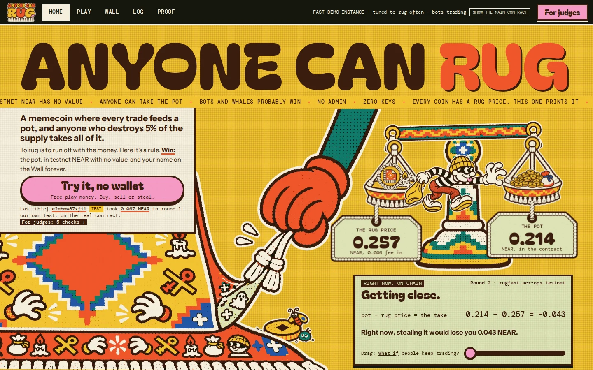

| The game, live on testnet | For judges: five requirements, five checks | On a phone |
|---|---|---|
| 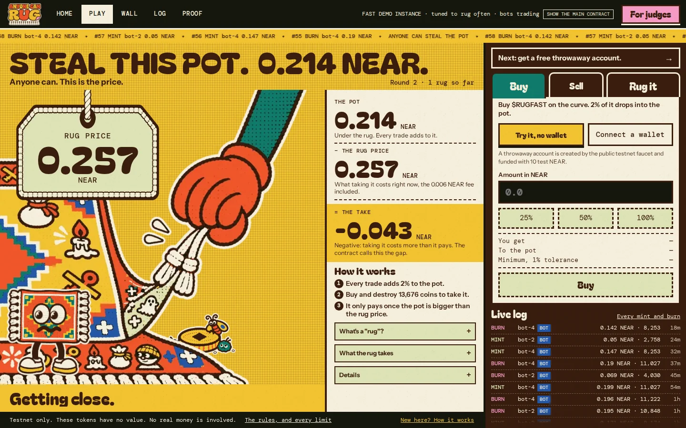 | 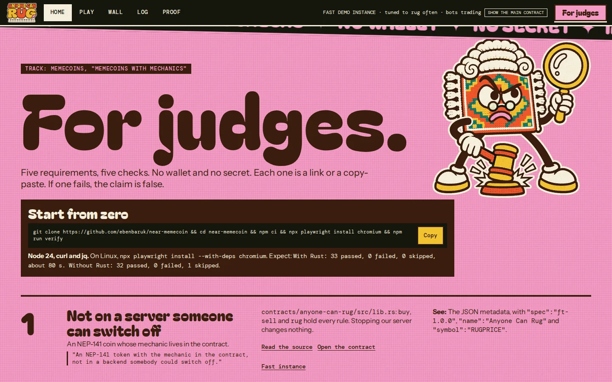 | 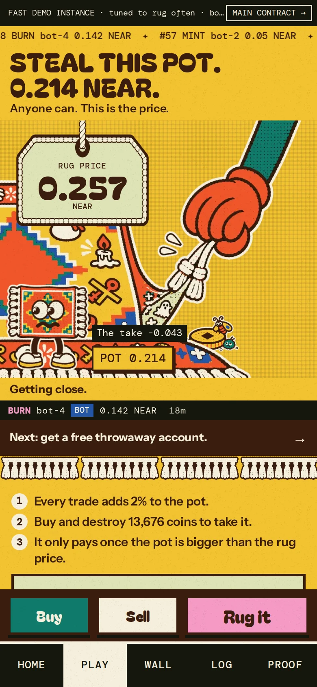 |

---

## Contents

1. [The pitch](#the-pitch)
2. [The mechanic in 10 seconds](#the-mechanic-in-10-seconds)
3. [Judge it in 5 minutes](#judge-it-in-5-minutes)
4. [Category requirements](#category-requirements)
5. [How a round plays out](#how-a-round-plays-out)
6. [What really happened on testnet](#what-really-happened-on-testnet)
7. [The page](#the-page)
8. [Contract](#contract)
9. [The math](#the-math)
10. [Attacks we thought about](#attacks-we-thought-about)
11. [Design decisions and what we rejected](#design-decisions-and-what-we-rejected)
12. [Why NEAR](#why-near)
13. [Simulation: 60 days, before parameters were chosen](#simulation-60-days-before-parameters-were-chosen)
14. [Limits, honestly](#limits-honestly)
15. [Architecture](#architecture)
16. [Tests](#tests)
17. [What `verify` proves, and what it does not](#what-verify-proves-and-what-it-does-not)
18. [What could come next](#what-could-come-next)
19. [FAQ](#faq)
20. [Repository map and local run](#repository-map-and-local-run)
21. [Other project by the same author](#other-project-by-the-same-author) · [Hackathon disclosure](#hackathon-disclosure) · [License](#license)

---

## The pitch

**The problem.** A rug pull is when the people behind a coin leave with the money. In most memecoins that exit exists. It is just private: someone holds a key, a large allocation, or a treasury they control, and nobody outside knows when they will use it or what it would cost them.

**The idea.** Make the rug a public method of the contract, and print its price. Anyone can call it, and nobody holds a special key. The price is the same for everyone. The moment the pot is worth more than the price, the first person to pay it takes everything.

**Why it is a mechanic and not a chart.** The track says "judges score the mechanic, and the price chart doesn't count". Here the chart barely matters. What players watch is one number: **the take**, pot minus rug price. When it turns positive, the coin becomes a race.

**What makes it a game.**
- **Tension you can see.** The pot grows with every trade. The rug price moves with the supply. The page shows both and the distance between them.
- **A race with fair rules.** Every rug names a round. If two people try at once, the second one is refused by the contract and only pays gas.
- **Glory on-chain.** Each rug is stored in the contract (`get_rugs`): who, which round, how much burned, how much taken. The page turns each one into a WANTED poster.
- **No villain to blame.** Nobody is behind the coin, so the joke turns around: rugging is the game and everyone is invited.

**What we claim and what we do not.**
- We claim that the rules live entirely in an immutable contract. We also claim that the price on the page is the contract's own number, that every mint and burn is logged on-chain, and that the parameters were chosen by a 60-day simulation before deployment.
- We do not claim it is fair to small players. Our own simulation says bots and whales will probably win, and we print that on the page and below.

We looked for prior art. Rug-themed games and "last buyer wins" coins exist. We did not find a token whose rug is a public, priced, permissionless method with the price printed live. If one exists, this is our take on it on NEAR.

## The mechanic in 10 seconds

- Every buy and sell on a linear bonding curve pays **2 %** into a **pot**.
- Anyone who burns **5 % of the supply** (`T`) takes the whole pot. Their name stays in the contract. A new round starts.
- The page prints the cost of doing that right now. When the pot is worth more than the price, the rug starts to lift.

```
T = ceil(tau * max(S, floor(0.9 * HWM)))     tau = 5 %, S = supply, HWM = remembered high of the supply
```

`HWM` rises with every buy that sets a new high. A rug resets it to `max(supply after the burn, 0.9 * HWM)`, so it shrinks by at most 10 % per rug. The `0.9 * HWM` term stops anyone from selling the supply down just before a rug to make `T` cheap. A rug burns tokens but does not take NEAR out of the curve reserve, so the NEAR behind burned tokens stays locked for good.

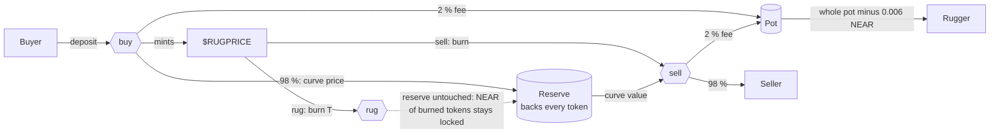

## Judge it in 5 minutes

Each step is "do X, see Y". None needs a secret or a wallet.

1. **Do** `npm ci && npx playwright install chromium && npm run verify` (Node 24, see `.nvmrc`; on Linux use `npx playwright install --with-deps chromium`; Rust optional, without it the Rust step prints `SKIP`). **See** a `PASS / FAIL / SKIP` table and exit code 0. A step that could not run prints `SKIP`, never `PASS`. The same command runs in GitHub Actions on every push (`.github/workflows/verify.yml`). Abridged real output:
   ```
   PASS  TypeScript unit tests (rules, invariants, determinism)
   PASS  Rust contract tests (unit, property, shared vectors)
   PASS  Shared vectors regenerate byte for byte
   PASS  Page builds
   PASS  Playwright smoke on fixtures, 390x844
   PASS  fast: account has zero access keys  (0 keys at block 277134142)
   PASS  fast: code hash equals committed wasm  (24xdnXK4NTyHrj7S82Bv1EzkNZBBguGy8qCAugor2s9m)
   PASS  fast: journal replays to ft_total_supply  (141 entries)
   PASS  fast: rug count equals round_id - 1  (3 rugs, round 4)
   ...
   33 passed, 0 failed, 0 skipped
   ```
2. **Do** read the keys of the contract:
   ```bash
   curl -s https://test.rpc.fastnear.com -H 'content-type: application/json' -d '{"jsonrpc":"2.0","id":1,"method":"query","params":{"request_type":"view_access_key_list","finality":"final","account_id":"anyonecanrug.testnet"}}'
   ```
   **See** `"keys":[]`. Same for `rugfast.acr-ops.testnet`. Without a key nobody can sign for that account, so nobody can redeploy or change a parameter, including the author.
3. **Do** open the demo. **See** a landing page with the 5 requirements under **For judges** (`#/judges`), then the game at `#/play`: the pot, the rug price, the take (pot minus rug price, called the gap in the contract), and the log of every mint and burn. Bot accounts carry a `BOT` badge derived from their `.acr-bots.testnet` suffix.
4. **Do** open a rug entry in the log and follow its explorer link. **See** the burn and the payout in a real testnet transaction. Two to try: bot-1's rugs of [round 2](https://testnet.nearblocks.io/txns/EQN8vY138D8fxLWE1vV2y931E57t6ASHcsBL3H3CAZVc) and [round 3](https://testnet.nearblocks.io/txns/FfqC6BLoZhacWstRdLBieb82ksxZCqYSTpzcczJBQsBu) on the fast contract. The explorer may block scripted browsers; `npm run verify:chain` checks the same facts over RPC.
5. **Do** `npm run try:testnet`. **See** a throwaway account created at the public faucet, then a buy, a sell, and a buy + rug in one atomic transaction on the fast instance, each with an explorer link. The account is deleted afterwards. The faucet rate-limits by IP; if it refuses, the script says so and exits with code 3.
6. **Do** `npm run sim -- --quick` (seconds). **See** a smoke run with 0 invariant violations and a matching golden hash. `npm run sim` rebuilds the tables below, deterministically from the seeds.

## Category requirements

The track prompt lists four requirements, plus the 60-day simulation it asks for first.

| Requirement | Where it is | Check it |
|---|---|---|
| NEP-141 with the mechanic in the contract | `contracts/anyone-can-rug/src/lib.rs`: `buy`, `sell`, `rug` hold all the rules. Stopping our server changes nothing | Step 5, or call `get_state` on the RPC |
| Parameters set at launch, readable, no admin key | `new(params)` runs once, in the deploy transaction. `get_params` is public. No setter exists in the source, and the account has no keys | Step 2; `npm run verify:chain` compares `get_params` with `deploy/*.json` and the code hash with the committed wasm |
| Sybil resistance good enough for a demo, limits written | `T` is a share of total supply, so splitting across accounts buys nothing. See [Limits](#limits-honestly): there is no identity check | `prop_split_buy_no_advantage` in `contracts/anyone-can-rug/src/tests/prop.rs`; the `sybil` scenario below |
| A page with state, progress and a log of every mint and burn | `web/`, reading the chain directly from the browser, with no backend for reads. The log comes from `get_journal` in the contract | Step 3. `verify` also replays the journal on-chain and compares it with supply and pot |
| 60-day simulation before choosing parameters | `sim/`, results in [Simulation](#simulation-60-days-before-parameters-were-chosen) | Step 6 |

How each requirement maps to the track's example ("a streak coin"): our "streak" is the round, our "daily target" is the rug price, our "high score" is the Rug Wall. The structure is the same: a rule in the contract, a number everyone watches, and a public record.

## How a round plays out

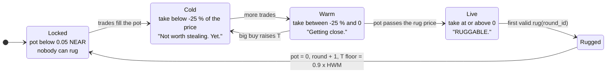

The page colours itself by these four zones (`data-zone="cold|warm|live|locked"`). The take can be negative and the page still lets you rug. It then says `You would lose {x} NEAR doing this.` and the button reads `Rug it anyway`.

**A real round, from the chain.** Round 3 on `rugfast.acr-ops.testnet`, rugged by `bot-1.acr-bots.testnet` on 2026-11-10 at 19:39 UTC ([tx](https://testnet.nearblocks.io/txns/FfqC6BLoZhacWstRdLBieb82ksxZCqYSTpzcczJBQsBu)):

| Field (from `get_rugs`) | Value | What it shows |
|---|---|---|
| `pot_before` | 0.2823 NEAR | Built by the 64 trades of the round, 2 % at a time |
| `supply_before` | 268,943 $RUGFAST | |
| `burned` | 13,790 $RUGFAST | 5.13 % of the supply, not 5 %: the `0.9 x HWM` floor was binding, because the supply had peaked near 306k earlier in the round. Selling the supply down did not make the rug cheaper |
| `payout` | 0.2763 NEAR | Pot minus the fixed 0.006 NEAR rug fee, which pays for the record's storage |
| Transaction | `buy` + `rug` in one batch | The bot held no tokens. It bought exactly `T` and burned it in the same atomic transaction |

**When two people race.**

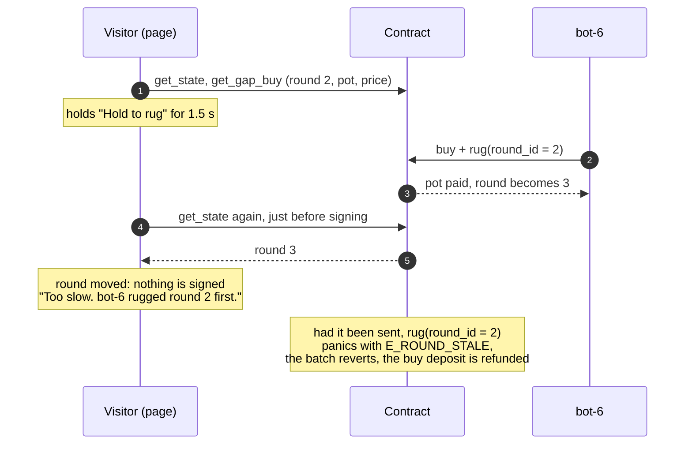

This is the end of the demo video, filmed with real transactions: the page saw the round move and sent nothing. A late `rug` that does reach the contract is refused with `E_ROUND_STALE`, and the whole batch reverts, buy included (contract and sandbox tests).

## What really happened on testnet

The fast instance has been running with five labelled demo bots since 2026-11-09. This chart is drawn only from the contract's own journal (`npm run charts:chain`, read-only):

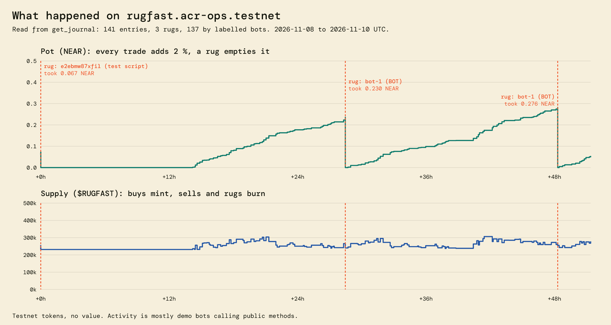

- Round 1 was rugged by our end-to-end test script, on deployment day.
- Rounds 2 and 3 were rugged by `bot-1.acr-bots.testnet` on its own, once the take turned positive. It took 0.230 NEAR ([tx](https://testnet.nearblocks.io/txns/EQN8vY138D8fxLWE1vV2y931E57t6ASHcsBL3H3CAZVc)) and then 0.276 NEAR ([tx](https://testnet.nearblocks.io/txns/FfqC6BLoZhacWstRdLBieb82ksxZCqYSTpzcczJBQsBu)).
- Both rugs appear in the page's log, with the `BOT` badge.

Snapshot taken on 2026-11-11 (the page shows the live numbers):

| | `rugfast.acr-ops.testnet` (fast) | `anyonecanrug.testnet` (simulated parameters) |
|---|---|---|
| Round | 4 | 2 |
| Rugs | 3 | 1 |
| Journal entries (every mint and burn) | 141 | 49 |
| Supply | 278,774 | 327,169 |
| Burned by rugs, forever | 39,645 | 7,684 |
| Curve reserve | 4.13 NEAR | 8.95 NEAR |

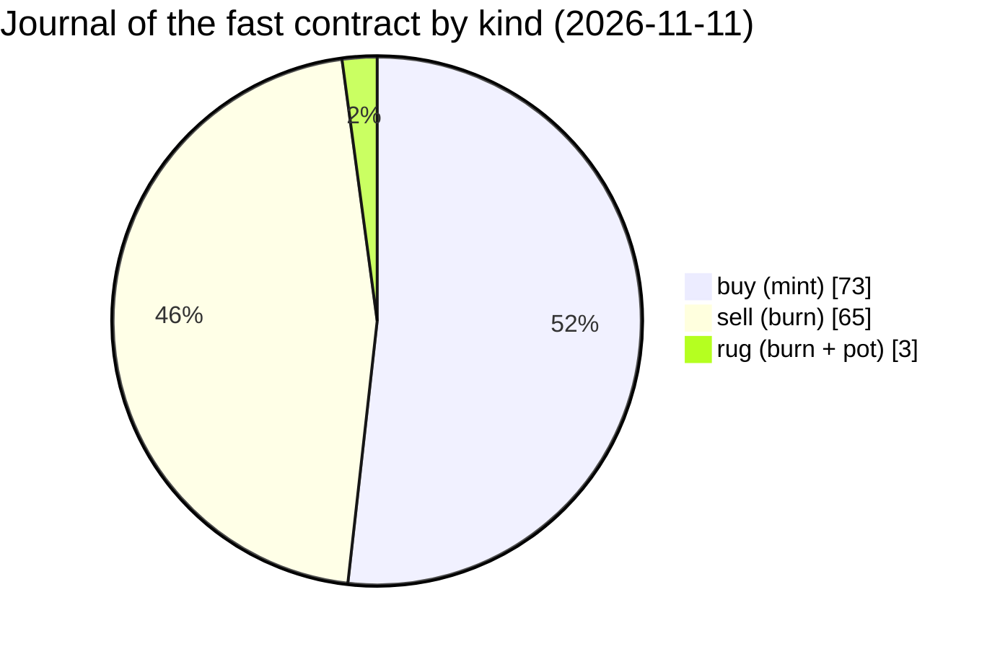

The bots are ordinary players: `bots/src/decide.ts` is a pure function of public views, and a bot rugs only when the printed price makes it worthwhile. Their keys live on the server, never in the page bundle. Stopping them stops the activity, not the coin.

## The page

Hash-routed, mobile first (390 × 844), also laid out for 1440 and 1920 px desktops. Every number comes from a contract view; the browser does no curve math.

| Route | What you see |
|---|---|
| `#/` | Landing: the pitch in diagrams, the live pot and rug price, the simulation, the five checks for judges |
| `#/play` | The game: the rug scene (the rug lifts as the take closes), pot, rug price, last event, `Buy / Sell / Rug it` |
| `#/wall` | Rug Wall: one WANTED poster per rug, biggest heist first, `BOT` badge, explorer link, shareable 1080 × 1350 PNG made in the browser |
| `#/log` | Every mint and burn since genesis, filters `All / Mints / Burns / Rugs / Mine / No bots`, and an `Audit` button that replays the whole journal and compares it with `ft_total_supply` |
| `#/proof/rules` | Every parameter from `get_params`, the account's live key count (expects `0 keys`), the code hash against the committed wasm, and the list of methods: `No owner method exists.` |
| `#/proof/sim` | The simulation results, with `Assumed behaviour. Not a forecast.` always visible and the bad results at the same size as the good ones |
| `#/proof/verify` | The "do X, see Y" list, each with a read-only `Run` button and the CLI equivalent |
| `#/judges` | The five requirements, each with its proof and a link |

**The rug flow, step by step.**
1. A frozen quote: round, pot seen, tokens to burn, tokens held, tokens to buy, estimated net take.
2. Without enough tokens, the page sends **one transaction with two actions**, `buy` then `rug`. On NEAR they run in one receipt, so if the rug fails, the buy is undone and the deposit refunded.
3. Slippage guards: deposit × 1.01, `max_burn = ceil(T × 1.01)`, `min_payout = pot seen − rug fee`.
4. **Hold to rug** for 1.5 s, with a ring. Releasing cancels. Accessible alternative: a two-step confirm, also on the keyboard.
5. Just before signing, the page reads `get_state` again. If the round moved, it shows "Too slow" and signs nothing.
6. When a rug lands, **every viewer** sees the climax (the round number went up), ending on the WANTED poster of whoever took it.

**Try it, no wallet.** The page makes an `ed25519` key in the browser and asks the public testnet faucet for a fresh 10 NEAR account. The key stays in `localStorage` and is never sent anywhere. Wallets work too (NEAR Connect). The faucet limits requests per IP. When it refuses, the page says `Faucet is busy.` and the rest keeps working.

**Honesty built into the page.** These lines are always shown: `Testnet only. These tokens have no value.`, `Anyone can take the pot, at any moment, including right after you buy.`, `Bots and whales will probably win.`, `Unaudited hackathon code.` The figures in them come from `web/public/sim/summary.json`, never from hand-typed text. A Playwright test fails if the page or this README contains a word we banned for promising things we cannot promise.

## Contract

Rust, `near-sdk` 5.30.1, 18 decimals, about 1,000 lines of source plus about 1,500 lines of tests. Source: `contracts/anyone-can-rug/`. Committed wasm: `contracts/anyone-can-rug/res/anyone_can_rug.wasm`, base58 sha256 `24xdnXK4NTyHrj7S82Bv1EzkNZBBguGy8qCAugor2s9m`, the same on all three accounts.

| Method | Effect |
|---|---|
| `buy(min_out)` payable | Mints on the curve, 2 % of the deposit goes to the pot. Registers the buyer automatically |
| `sell(amount, min_out)` 1 yocto | Burns, pays the curve value minus 2 % |
| `rug(round_id, min_payout, max_burn)` 1 yocto | Burns `T`, pays the pot minus a small fixed fee, opens a new round. Can sit in the same transaction as a `buy` |
| `get_params`, `get_state`, `get_gap_buy`, `get_gap_holder`, `get_gap_exit`, `quote_buy`, `quote_sell`, `get_rugs`, `get_journal` | Views, no key needed |
| NEP-141, NEP-145, NEP-148, NEP-297 events | Standard, with one deviation listed in Limits |

**Stable error codes** (every panic message starts with one, so the page and scripts can react):

| Code | When |
|---|---|
| `E_ROUND_STALE` | `round_id` is not the current round: someone rugged first |
| `E_POT_BELOW_MIN` | Pot below the minimum (0.05 NEAR) |
| `E_BURN_ABOVE_MAX` | `T` grew above the caller's `max_burn` (someone bought just before) |
| `E_PAYOUT_BELOW_MIN` | Pot dropped below the caller's `min_payout` |
| `E_INSUFFICIENT_TOKENS` | Balance below `T` or the sell amount |
| `E_SLIPPAGE` | `min_out` not met |
| `E_BELOW_MIN_BUY`, `E_SELL_TOO_SMALL`, `E_ABOVE_X_MAX` | Size limits |
| `E_UNREGISTER_DISABLED` | Any `storage_unregister` (see Limits) |

**Events.** Standard `nep141` `ft_mint` / `ft_burn` (memo `buy`, `sell`, `rug`), plus a custom `anyone_can_rug` standard with `buy`, `sell`, `rug`, `payout_failed`, for indexers and for judges reading a transaction.

**The journal is in the contract.** Every mint and burn is stored on-chain (`get_journal`), with its storage prepaid by whoever made it (0.003 NEAR per trade, 0.006 NEAR per rug). The page needs no indexer and no backend to show the full history. The journal never shrinks: a mint and burn log that deletes history would not be a log.

**Failed payouts.** Payouts are promises with a callback. If a transfer fails (say the receiver deleted their account), `on_payout` credits the pot and journals a `payout_failed` entry, so replaying the journal still reproduces the pot exactly. Tokens already burned stay burned.

**Solvency.** After every `buy`, `sell` and `rug`, the contract asserts `balance − outgoing ≥ reserve + pot + storage cost`. `verify` checks the same identity from outside.

| Parameter | `anyonecanrug.testnet` | `rugfast.acr-ops.testnet` |
|---|---|---|
| Source | Selected by the simulation | Chosen for the demo, not by the simulation |
| Curve | `p = 0.00001 + 1e-10 * S` NEAR | `p = 0.000005 + 5e-11 * S` NEAR |
| Fee / burn | 2 % / 5 % | 2 % / 5 % |
| HWM floor | 90 % | 90 % |
| Minimum pot to rug | 0.05 NEAR | 0.05 NEAR |
| Minimum buy | 0.05 NEAR | 0.02 NEAR |
| Journal fee / rug fee | 0.003 / 0.006 NEAR | 0.003 / 0.006 NEAR |

| Step | `anyonecanrug.testnet` | `rugfast.acr-ops.testnet` |
|---|---|---|
| Deploy + init, one transaction | [`DfCp5P3S…`](https://testnet.nearblocks.io/txns/DfCp5P3SsivRPvDmmB2V5PnGYMxMp4jcwxaUz3DxJdkA) | [`E7hkM1C2…`](https://testnet.nearblocks.io/txns/E7hkM1C2eWpDUA4b4Up67LgJdFuragqJHbBmQYQPnPDw) |
| Key deletion | [`45F2veW8…`](https://testnet.nearblocks.io/txns/45F2veW87pLfT4GPxRhUQUrResnpqPixbGo8qjj1TZWa) | [`7hfDsLZo…`](https://testnet.nearblocks.io/txns/7hfDsLZo4MLeDTjpoHf84fzb2hzTwMum3MmrDeN2imwB) |

A third instance, `film.acr-ops.testnet`, was used only to shoot the video: same wasm, the fast parameters (`deploy/film.json`, symbol `RUGFILM`), deployed in [`DXnfSBh7…`](https://testnet.nearblocks.io/txns/DXnfSBh71K12KP3nR1ZprTzkzDTt3GNJspdGR8DroXF6), keys deleted after the shoot in [`9zos1hdd…`](https://testnet.nearblocks.io/txns/9zos1hdddw2fkmByKLz1UA2ZGhfnh1N1TC55o6MPNp3G). `verify` does not cover it.

## The math

All of it is integer math in `contracts/anyone-can-rug/src/math.rs` (U256 inside, `u128` out). The same rules are written a second time in TypeScript (`sim/src/rules.ts`), and both are held equal by 523 shared vector sequences.

**Curve.** Linear price in the curve position `x`:

```
p(x) = p0 + a·x
r(x) = ceil( (2·p0·ONE·x + a·x²) / (2·ONE²) )             reserve needed to be at position x
inv(R) = floor( ONE·(isqrt(p0² + 2·a·R) − p0) / a )        position reached with reserve R, rounded down
```

`r(inv(R)) ≤ R` for every integer `R`, so a buy can never charge more than was paid. Fees always round up. The leftover dust of each buy goes to the pot.

**Two numbers for the curve.** The supply `S` is the tokens in circulation. The position `x` is where the curve sits. A sell lowers both. A rug burns `T` from `S` but leaves `x` and the reserve where they are. So `x − S` is the sum of all rug burns, and the NEAR behind them, `r(x − S)`, can never leave the contract. `verify` checks `x − supply == Σ rug burns` on-chain.

**The floor.** Selling every token moves `x` down to `B = x − S`, never below. So the last token always sells at `p(B)`, which rises with each rug. That is a position on the curve, in NEAR, and nothing more. It does not promise any value.

**The rug price.** What the page prints is `get_gap_buy(account).cost + rug_fee`: the NEAR you need to buy enough tokens to hold `T` (fees included, since they land in the pot you take), plus the fixed fee. The take is `pot − rug price`. Solving "how many tokens to buy so that I hold 5 % of the supply after my own buy" gives:

```
dx = max( ceil((tau·S − bal·10000) / (10000 − tau)),  ceil(tau·floor(0.9·HWM) / 10000) − bal ) + margin
```

The margin covers the floored square root. A property test (`prop_gap_buy_rug_always_succeeds`) checks that the deposit and `min_out` from `get_gap_buy` always make the batch succeed.

**Why the pot catches up.** Each trade adds 2 % of its size to the pot. Buying `T` costs about `5 % × S × spot price`. On a linear curve that starts near zero, the spot price is about twice the average price paid, so that is about 10 % of the reserve, and the pot catches it after trading volume of roughly five reserves. On the live parameters at 1M supply: reserve 60 NEAR, `T` = 50,000 tokens, buy-then-rug costs about 5.75 NEAR, and the pot gets there after about 4.8 reserve turnovers. The ratio `tau / f = 2.5` sits inside the band the simulation found viable (1 to 10). Below it, rugs are instant. Far above it, they never happen.

## Attacks we thought about

| Attack | What stops it, or why it does not matter | Tested by |
|---|---|---|
| Two ruggers at once | The rug names its `round_id`; the second one fails `E_ROUND_STALE` before any token moves | `rug_wrong_round_reverts`, sandbox batch tests |
| Sell the supply down, then rug cheaply | `T` never drops below `5 % × 0.9 × HWM` | `t_required_max_of_s_and_floor`, round 3 above |
| Pump `S` right before someone's rug | Their `max_burn` makes the rug revert; the pumper pays 2 % into the pot | `rug_max_burn_exceeded_reverts` |
| Flash buy → rug → sell for free NEAR | Pays 2 % twice; `T` is computed after the buy. Net gain is bounded by the printed take | `prop_no_free_rug` (property test, random sequences) |
| Split buys over many accounts | `T` counts tokens, not accounts; split buys never mint more | `prop_split_buy_no_advantage`, `sybil` scenario |
| Drain the pot with rounding round trips | Path-independent `r`, fees round up | `prop_round_trip_loses_exactly_fees` |
| Call the callbacks directly | `on_payout` and `ft_resolve_transfer` are `#[private]` | `on_payout_not_private_callable_rejected`, `resolve_not_callable_externally` |
| Re-entrancy | All state is written before the only outgoing promises (payouts, `ft_transfer_call`) | Sandbox flow tests |
| Spam accounts to bloat storage | Registration and journal entries are prepaid by the caller | `journal_fee_covers_64_char_account` |
| The author changes the rules | No setter in the source, zero access keys, code hash checked | `grep_no_admin` lint, `verify` |
| A whale | **Not prevented.** A 25 % holder took 99 % of rugs in the simulation | `whale` scenario, written in Limits |
| Reordering by chunk producers | No public mempool like Ethereum's, but ordering is not promised; `min_out`, `min_payout`, `max_burn` bound the damage | |

## Design decisions and what we rejected

| Decision | Why | Rejected alternative |
|---|---|---|
| `T` is a share of supply | One rule for everyone, no identity needed, splitting is useless | Per-account caps: meaningless on a chain where accounts are cheap |
| `T` floor at `0.9 × HWM` | Stops the sell-down-then-rug trick; decays 10 % per rug so a dead coin can still be rugged | No floor (exploitable), a fixed snapshot per round (lets a whale freeze the price) |
| Rug burns tokens, keeps the reserve ("mode C") | The pot is the only prize, the curve stays solvent, and the floor rises with each rug | Paying the rugger from the reserve: turns the game into a bank run |
| Buy and rug as two actions in one transaction | Atomic on NEAR, no extra `buy_and_rug` method to audit | A helper method; a relayer signing for players (a key and a server someone could switch off) |
| `round_id` in every rug | The cheapest possible race protection, checked before anything moves | Commit-reveal: two transactions, slower than the game |
| Journal stored in the contract | The page reads every mint and burn with no indexer; judges can replay it | Indexer or our own database: a backend that could lie or go down |
| Zero keys after deploy | The strongest "no admin" proof NEAR offers: nobody can sign for the account | An owner with a timelock or a DAO: still an admin |
| Two instances, same wasm | Judges see action on `fast` and the simulated parameters on `live`, with one code hash | One instance: either too slow to see a rug, or parameters not from the simulation |
| `storage_unregister` always panics | Closes a griefing path where a refund could silently burn tokens | Standard unregister: needs extra code paths in a contract with no way to patch |
| Parameters chosen by simulation before deploy | The prompt asks for it, and it showed `tau / f` must stay between about 1 and 10 | Guessing, then tuning on mainnet |

The full reasoning, including ideas we dropped (a reverse Ponzi, a "biggest loser" coin, a timed door), is in `Docs/` (in French): `02-brainstorm.md`, `05-brainstorm-wow.md`, and the spec in `Docs/spec/`.

## Why NEAR

| NEAR feature | What it gives this game |
|---|---|
| Batch actions in one receipt | `buy` + `rug` in one transaction, all or nothing. A player holding no tokens can still rug in one click, and a failed rug costs them only gas |
| Access keys that can be deleted | "No admin" is not a promise in a README: the account has no key, and anyone can check it with one RPC call |
| Named accounts | Bots are `bot-N.acr-bots.testnet`, so the page's `BOT` badge is derived from the name and anyone can verify it |
| Storage staking | Each journal entry is paid for by the trade that creates it, so the full log can live in the contract |
| Promises with callbacks | Payouts that fail are caught and credited to the pot, never lost silently |
| About one-second blocks | A race on a pot is playable in a browser |
| Public RPC with CORS | The page reads the chain directly, with no backend; if our server goes down, the coin and the page (served from anywhere) keep working |
| Testnet faucet API | "Try it, no wallet": a real account in one click, with no signup |
| NEP-141 / NEP-145 / NEP-297 | Any wallet or indexer understands the token, its storage and its events |

## Simulation: 60 days, before parameters were chosen
These results come from **modelled agents whose behaviour we assumed**. Nothing is fitted to real trading data.
They compare parameter choices. They are not a forecast and imply no gain for anyone.

Reproduce: `npm run sim -- --quick` (seconds) or `npm run sim` (about 142 min). Seeds and code are in `sim/`.
Rules are integer-exact and replayed against the contract with 523 shared test vectors (25078 steps).

**Agents.** Retail traders (arrivals, sizes and exits drawn from assumed distributions, momentum and loss sensitivity), snipers watching the take, a whale aiming for a target share, wash traders, a sybil running many accounts, and panic sellers after a rug. Eleven scenarios mix them. Every scenario also runs on two **control coins** with the same curve and the same agents but no rug: fees destroyed (A) or no fees (B).


| Scenario | Games with no rug | Median rugs | Supply at day 60 vs control | Retail vs fee-burn control |
|---|---|---|---|---|
| organic | 0% | 3 | -10.0% [-11.4, -7.7] | +3.3 [+3.3, +3.3] |
| no-bot | 88% | 0 | -1.2% [-2.3, -0.0] | +0.0 [-0.0, +0.0] |
| whale | 0% | 2 | -18.3% [-19.2, -17.1] | -2.3 [-2.4, -2.2] |
| wash | 0% | 11 | -34.9% [-36.0, -33.6] | +6.9 [+6.9, +6.9] |
| sybil | 0% | 3 | -33.4% [-34.9, -32.6] | -1.7 [-1.8, -1.6] |
| panic-early | 0% | 3 | -9.2% [-10.9, -7.6] | +3.0 [+2.9, +3.0] |
| panic-after | 0% | 3 | -8.2% [-9.8, -7.3] | +2.9 [+2.9, +2.9] |
| hype | 0% | 5 | -19.7% [-21.7, -17.4] | +3.1 [+3.1, +3.2] |
| dead | 0% | 2 | -26.4% [-35.5, -15.3] | +3.2 [+3.2, +3.2] |
| tiny | 0% | 2 | -15.8% [-21.8, -8.0] | +2.6 [+2.5, +2.7] |
| all-in | 0% | 7 | -55.2% [-58.4, -52.5] | -4.2 [-4.5, -3.6] |

**Control coin:** same bonding curve and same agents, but no rug; fees are destroyed (A) or absent (B).
Retail column: paired median difference in percentage points of capital invested, with bootstrap CI.

**Who takes the pot.** Snipers take most rugs when they are present; with a whale, the whale takes 99 %. Retail takes rugs mainly when nobody faster is watching (`no-bot`, `tiny`).

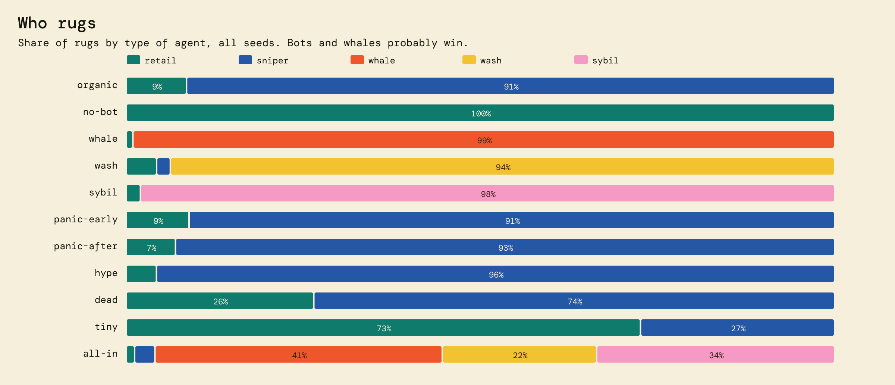

**Retail against the control coins.** Against control A (fees destroyed) retail does a little better in most scenarios, because the fees come back as pots that someone in the game takes. Against control B (no fees at all) retail does worse almost everywhere: the 2 % fee is a real cost, and a whale or a sybil makes it worse.

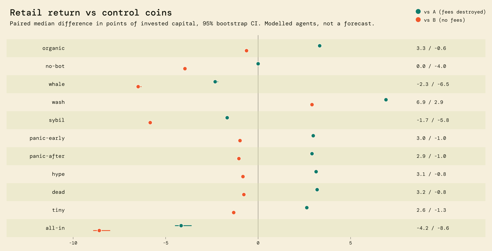

**Parameters chosen:** tau 5%, fee 2%, curve p = 0.00001 + 1e-10·S NEAR, Pmin 0.05 NEAR, selected by the rule in `Docs/spec/30-simulation.md`.
The viable band is tau/f between 1.0 and 10.0, measured on a 20-seed screen of 505 (cell, Pmin) pairs; the 11 finalists were confirmed on 100 seeds and scored on 200 assumption draws:


**Which assumptions matter.** One factor at a time around the chosen point. A cross marks a value that pushes the parameters out of the viable band.

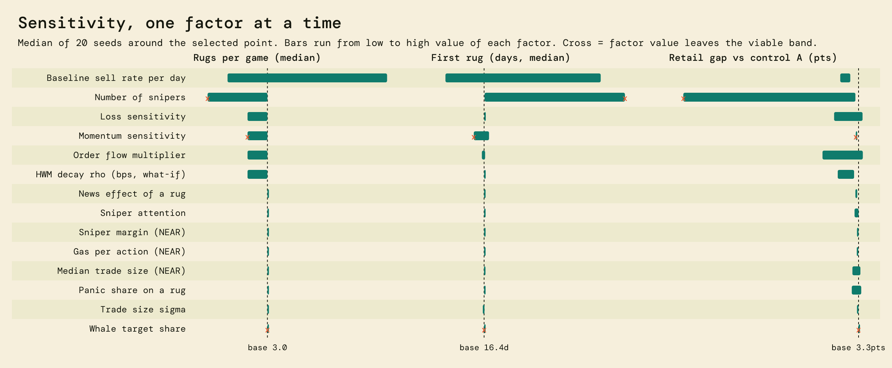

**What the model says that you should not like**
- Bots and whales will probably win. With a 25% holder in the game, that holder took 99% of rugs.
- Without an attentive bot, 88% of modelled games saw no rug.
- Assumptions that change the conclusion most: Whale target share (rank corr. with viability -0.29); Baseline sell rate per day (rank corr. with viability 0.24); Momentum sensitivity (rank corr. with viability -0.18).
- Single assumptions that alone push the selected point out of the viable band: Momentum sensitivity, Number of snipers, Whale target share.
- Timing depends on an assumed order flow; at demo scale, with order flow at 2% of the base case, 100% of modelled games saw at least one rug, median 2 rugs.

## Limits, honestly

- **"Anyone can take the pot" is the whole promise.** Fees are 2 % per trade, in and out. Bots and whales will probably win. In the simulation, 88 % of games without an attentive bot saw no rug, and a 25 % holder took 99 % of the rugs. Behaviour in the simulation is assumed, not measured.
- **Demo activity comes from bots.** They only call public methods, and their accounts are labelled. None of it is a community. Left alone, `bot-1.acr-bots.testnet` rugged rounds 2 and 3 of the fast contract and took 0.230 and 0.276 NEAR ([round 2](https://testnet.nearblocks.io/txns/EQN8vY138D8fxLWE1vV2y931E57t6ASHcsBL3H3CAZVc), [round 3](https://testnet.nearblocks.io/txns/FfqC6BLoZhacWstRdLBieb82ksxZCqYSTpzcczJBQsBu)). Both rugs appear in the page's log.
- **How the video was made.** It is the real page on `film.acr-ops.testnet`, driven by a script (`scripts/video/`), with real testnet transactions. Its trades come from `bot-6.acr-bots.testnet`, a labelled bot. The visitor's throwaway account was created by our operator account, with the page's own key and the faucet's 10 NEAR, because the public faucet was rate-limiting our IP; its NEAR went back to the operator afterwards. In the lost race at the end, the script made bot-6 send its real rug while the visitor was holding the button; the page saw that the round had moved and sent nothing. A rug that does reach the contract late is refused with `E_ROUND_STALE` (contract tests). Parts of the waiting time are sped up.
- **The floor is a position on a bonding curve**, reachable only by selling along that curve. It says nothing about value.
- **Burned tokens' NEAR is locked forever** in the reserve. This is the design.
- **Sybil resistance: there is none for the threshold, and none is claimed.** `T` is a share of supply, not a per-account limit. An attacker with many accounts gains nothing and pays gas and registration, which only slows them down. It is enough for a testnet demo and nothing more.
- **Transfers are ordinary NEP-141.** A wrapper or an outside market is not prevented.
- **Immutable means a bug cannot be fixed.** A fix would be a new contract account, and the old one would stay.
- **Testnet only.** Testnet NEAR has no value.
- **NEP-145 deviation:** `storage_unregister` always panics, so registration storage is never refunded. This closes a griefing path.
- **`verify` checks keys, code hash and bookkeeping of past operations.** It does not prove future behaviour, nor that the source compiles to the deployed wasm. For behaviour, read the tests and run `try:testnet`.
- **The wasm is built with `cargo near build non-reproducible-wasm`.** A rebuild is not expected to give the same hash. The proof is about the committed binary.
- **The simulation campaign was reduced for runtime.** The viable band rests on a 20-seed screen, and a cell outside the top 10 of the screening could have been missed. The finalists are within noise of each other.
- **Not tested end to end:** signing with a real browser wallet. Wallet flows use a stubbed signer in Playwright; real transactions are covered by the sandbox tests, `scripts/e2e-testnet.ts` and `try:testnet`.
- **Unaudited hackathon code.** Nobody outside this project has reviewed the contract.

## Architecture

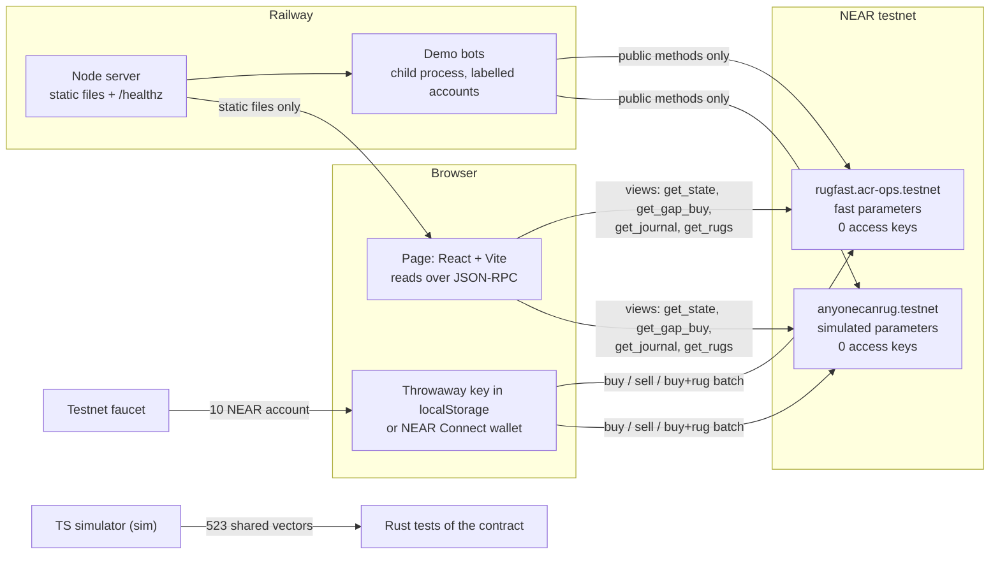

- **Reads**: plain JSON-RPC from the browser (about 40 lines, no dependency), with fallback across three public RPCs. If all fail, the page shows a dated frozen copy (`web/public/snapshots/`) and disables trading.
- **Writes**: `near-api-js` 7.4 for throwaway keys, `@hot-labs/near-connect` for wallets. Both are loaded only on the first trade, so the first screen stays under 120 KB gzip (a test enforces it).
- **Server**: serves the built page and runs the bots. It holds no contract key, because none exists. If it goes down, the mechanic keeps working, and so does anyone serving `web/dist` locally.

## Tests

| Level | Covers | Count | Run |
|---|---|---|---|
| Contract unit and property | NEP-141, buy, sell, rug, rounding, no privileged method, no free rug, split buys | 83 | `cargo test` in `contracts/anyone-can-rug` |
| Shared vectors | TypeScript rules vs Rust, every field to the yocto | 523 sequences, 25 078 steps | included above; `npm run sim -- check-golden` |
| Sandbox | Promises, callbacks, refunds, atomic batches, failed payouts, gas | 9 | `cargo test -p integration-tests` |
| Testnet smoke | Real transactions, on a rehearsal then on final accounts | 29 checks | `npx tsx scripts/e2e-testnet.ts <contract>` |
| Simulator and bots | Rules, scenarios, bot decisions | 32 + 10 | `npm test -w sim`, `npm test -w bots` |
| Page, 390×844, 1440×900 and 1920×1080 | Every screen and state, on captured real RPC responses | 184 across the three viewports | `npm run e2e` |
| Production | The deployed site, per instance: pot and rug price on screen match the chain, the log shows every journal entry, zero keys on screen and over RPC; no transaction is sent | 3 × 2 instances | `E2E_BASE_URL=https://web-production-69c90.up.railway.app npm run e2e:prod` |
| Chain | Keys, code hash, params, journal replay, solvency on both contracts | 26 of the 33 `verify` checks | `npm run verify:chain` |

The property tests run random sequences of buy, sell, rug and transfer from five accounts, and check after every step:
- `reserve == r(x)`, `x − S == Σ rug burns`, and solvency;
- supply equals the sum of balances, and journal replay gives both supply and pot;
- the HWM is monotone except at rugs and never below `S`, and the round never goes back;
- no free rug, split buys give no advantage, and the batch from `get_gap_buy` always succeeds.

The shared vectors are generated with integer and correctly rounded floating-point operations only, so they regenerate byte for byte on ARM64 and x86 alike.

## What `verify` proves, and what it does not

| Proves | Does not prove |
|---|---|
| Both accounts have zero access keys, at a pinned final block | That the source compiles to the deployed wasm (the build is not reproducible) |
| The deployed code hash equals the committed wasm | Future behaviour: for that, read the tests |
| `get_params` equals `deploy/*.json` | That anyone will ever rug again |
| `reserve == r(x)`, recomputed in BigInt outside the contract | That the parameters are good for real players: the simulation assumed their behaviour |
| The contract is solvent | |
| Replaying the whole journal gives `ft_total_supply` and the pot | |
| Every rug record matches its journal entry, and `rug count == round_id − 1` | |
| The tests, the vectors, the page build and the simulation run | |

## What could come next

These are ideas, not commitments. None of them is built.

- **Mainnet only after an outside audit.** Also a reproducible build, and simulation parameters re-fitted on the order flow observed on testnet instead of assumed.
- **One factory, many coins.** The same wasm deployed per coin with its own frozen parameters, and one Rug Wall across all of them.
- **A "rug price" view other tokens could adopt.** Any coin with a treasury could expose what it would cost to take it. The views here (`get_gap_buy`, `get_gap_holder`, `get_gap_exit`) are a first draft of that interface.
- **A launchpad.** The track's partner, meme.cooking, is the obvious place to try. It would need either a port of the curve or a rug module on top of their model.
- **Alerts when a pot turns ruggable.** A read-only bot on X or Telegram. It would be off-chain and optional, and the coin would not depend on it.
- **Real wallet coverage.** End-to-end signing tests with the NEAR Connect wallets.

## FAQ

**Is this a lottery?** No draw, no randomness. The price is printed and deterministic. Whoever pays it first, with a valid round, takes the pot. Speed and attention decide, which is why bots probably win.

**Can the author take the pot or change the rules?** Not by any special means. The accounts have no access keys (step 2), the code has no owner field or setter (`grep_no_admin`), and the code hash matches the committed wasm. The author can rug like anyone else, at the printed price.

**Why would anyone buy?** To trade on the curve, to race for the pot, or to hold while others pay fees into it. The page says plainly that a round trip costs 2 % each way and that bots and whales will probably win. It is a game on testnet with tokens of no value.

**What if your server or the bots stop?** The contract keeps working. The page reads public RPCs and can be served from anywhere (`npm run web`). Without bots, the coin just gets quieter; the simulation's `no-bot` scenario shows what that looks like.

**Why is there a fast instance?** At the simulated parameters a rug needs real volume. The fast instance runs the same wasm with a cheaper curve, so a judge can see a rug in minutes. The banner on every screen says which instance you are looking at.

**Does the floor mean the token keeps a value?** No. It is the price of the last token on the curve, in NEAR. It rises with each rug because burned tokens never come back to the curve. It is not a promise about anything.

## Repository map and local run

```
contracts/anyone-can-rug/   Rust contract: lib.rs (methods), math.rs (curve), events.rs, tests/ (unit, property)
  res/anyone_can_rug.wasm   the committed binary deployed on all three accounts
integration-tests/          sandbox tests against the wasm (promises, batches, failed payouts, gas)
sim/                        60-day simulator in TypeScript BigInt, scenarios, sweep, charts
fixtures/vectors.json       523 shared sequences replayed by TypeScript and Rust
deploy/                     frozen init parameters: live.json, fast.json, film.json
web/                        the page (Vite, React, TypeScript), reads the chain directly
bots/                       demo bots (pure decision function) and the production server
scripts/                    verify, verify:chain, try:testnet, e2e-testnet, deploy and lock, charts, video
e2e/, e2e-prod/             Playwright tests on fixtures (3 viewports) and on the deployed site
docs-assets/                screenshots, simulation charts, chain history chart, video
Docs/                       research, brainstorm, spec and build journal (in French)
```

Local run: `npm ci`, then `npm run web` and open `http://localhost:5180`. Production server: `node bots/server.mjs` after `npm run -w web build`. Bots need their own testnet keys in `.env` (see `.env.example`); nothing else needs a secret.

## Other project by the same author

[TokenGo](https://github.com/ebenbaruk/TokenGo) (track: games), also by Eli Benbaruk. The two projects are independent: no shared code, contract or token.

## Hackathon disclosure

All code in this repository was written from 2026-11-08 on, with no prior codebase. Code, tests and docs were mainly generated with Claude Code under the direction of the solo developer. The design documents are in `Docs/`.

Libraries: near-sdk, near-contract-standards, near-workspaces, cargo-near, near-cli-rs, near-api-js, @hot-labs/near-connect, React, Vite, TypeScript, Vitest, Playwright, tsx, dotenv, @resvg/resvg-js, Fontsource (Bagel Fat One, Instrument Sans, DM Mono), ffmpeg.

## License

MIT, see [LICENSE](LICENSE). Copyright 2026 Eli Benbaruk.
